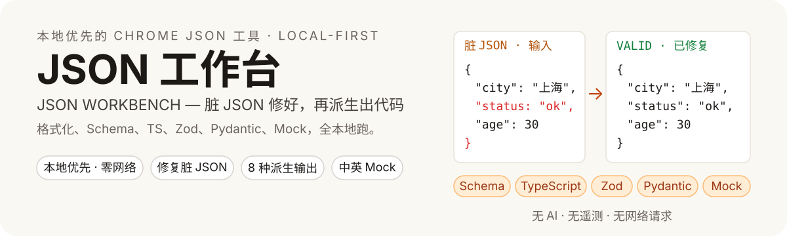
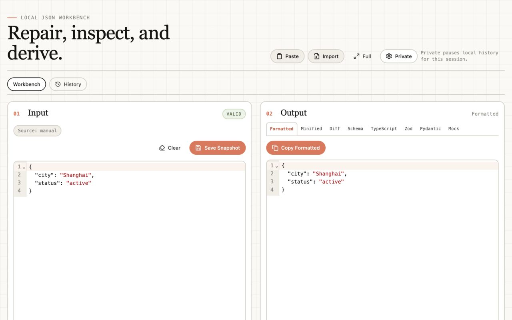
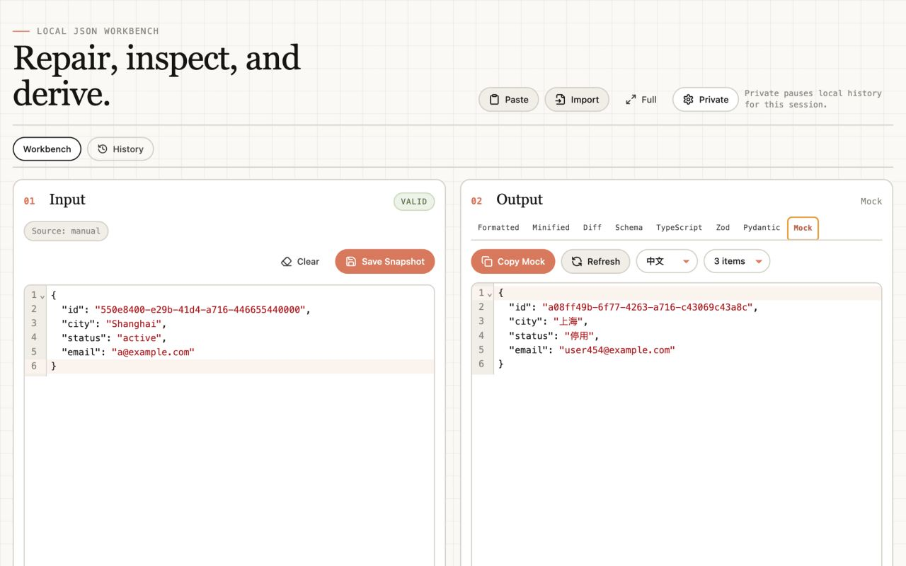

<p align="right"><a href="README.md">中文</a></p>

<p align="center">
  
</p>

<p align="center">
  <a href="https://github.com/holynova/json-workbench-extension">GitHub Repository</a>
</p>

JSON Workbench is a local-first Chrome extension for JSON: repair dirty JSON, format it, then derive JSON Schema, TypeScript, Zod, Pydantic, and semantic mock data. No AI, no telemetry, no network requests — everything runs locally in the browser. Current version **v0.1.0** (Manifest V3).

## Screenshots

<p align="center">
  
</p>

<p align="center">
  
</p>

## Features

- **Repair dirty JSON**: strips Markdown code fences, detects JSON / JSONL / JSON-like blocks in noisy text, extracts the most likely block, repairs it conservatively with `jsonrepair`, and validates with `JSON.parse`. On failure, no derived outputs are generated and diagnostics are shown (line/column, nearby snippet, likely cause, suggested manual fix).
- **8 derived outputs**: formatted, minified, original-repair diff, JSON Schema, TypeScript, Zod, Pydantic v2, semantic mock; every output tab has its own copy button.
- **JSON Schema**: 2020-12 by default, Draft-07 optional; infers formats like uuid, email, uri, date-time, IP, phone, color, latitude/longitude, and currency.
- **TypeScript / Zod / Pydantic**: TypeScript defaults to `interface` with PascalCase class names; Zod generates named constants like `RootSchema`; Pydantic v2 models use aliases for keys that aren't valid Python identifiers.
- **Semantic mock data**: local semantic rules + Faker, English/Chinese locales, with refresh, deterministic seeds, array counts, and custom rules. History saves the language and seed, so earlier mocks are reproducible.
- **Input sources**: manual typing, paste (clipboard is read only after you click), selected page text (context menu), file import (`.json` / `.txt` / `.log`), JSONL as a first-class format, and extracting all JSON blocks from logs or mixed text.
- **Local history**: inputs are saved to local history automatically, pausable (Private mode); history stays on your machine.

## Surfaces

- **Side panel**: the main interface, with a top toolbar (paste, import file, open full page, settings) and three main tabs — input / output / history. Open it with `Alt+Shift+J`.
- **Full-page workbench**: for larger data and longer generated code — input, history, and repair report on the left, output on the right.

## Privacy

- No network, no AI, no telemetry; the content security policy restricts `script-src 'self'`.
- Only four permissions: `sidePanel`, `contextMenus`, `storage`, `clipboardRead`. The clipboard is read only after you click the paste button; selected page text is handled only through an explicit context-menu action, never auto-monitored. See [docs/PRIVACY_POLICY.md](docs/PRIVACY_POLICY.md).

## Install

Load from source (not yet published on the Chrome Web Store):

```bash
git clone https://github.com/holynova/json-workbench-extension.git
cd json-workbench-extension
npm install
npm run package:chrome   # Build and package; output in release/
```

Then open `chrome://extensions` in Chrome, turn on developer mode, click 「加载已解压的扩展程序」 ("Load unpacked"), and select the `dist/` directory. Or download a zip from [Releases](https://github.com/holynova/json-workbench-extension/releases), unzip it, and load that.

Development: `npm run dev` (Vite, `http://127.0.0.1:5173`); tests: `npm test` (Vitest); type check: `npm run typecheck`.

## Tech

- React 18 + TypeScript + Vite; the editor is CodeMirror 6 (JSON / JS / Python highlighting).
- Repair engine `jsonrepair`; mocks use `@faker-js/faker`; history uses Dexie (IndexedDB).
- Core logic lives in `src/core/`: `repair.ts` (repair), `infer.ts` (type and format inference), `schema.ts` / `typescript.ts` / `zod.ts` / `pydantic.ts` / `mock.ts` (derivers), `semantic.ts` (semantic rules). Processing runs in a Web Worker (`src/worker/processor.ts`) so the UI never blocks.

```
public/manifest.json    Manifest V3: sidePanel + contextMenus + storage + clipboardRead
src/core/               Repair, inference, and derivers (pure functions, unit-testable)
src/ui/                 App / CodeEditor / styles (React + CodeMirror)
src/worker/             Processor: repair and generation on a background thread
src/history/            Dexie local history
src/extension/          Background service worker
docs/                   Product spec, privacy policy, store checklist
store-assets/           Store screenshots and promo art
```
