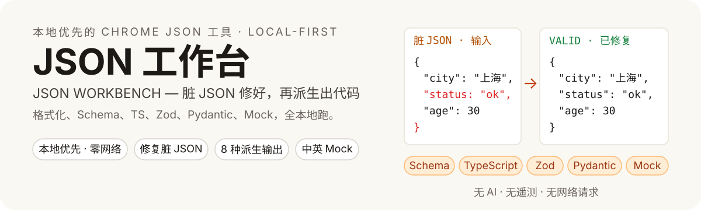
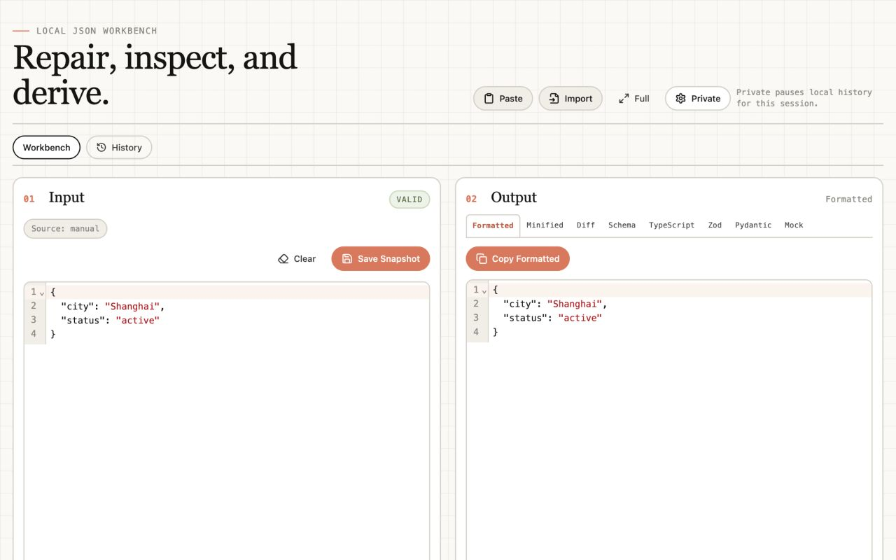
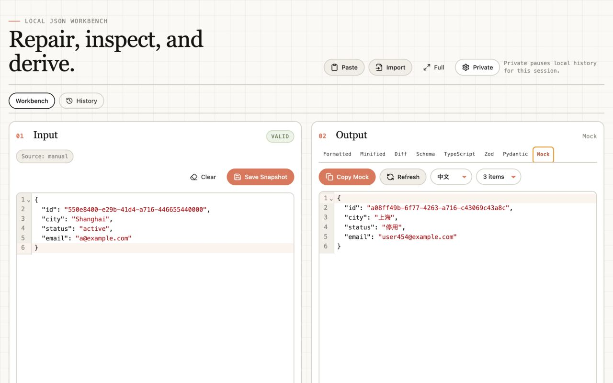

<p align="right"><a href="README.en.md">English</a></p>

<p align="center">
  
</p>

<p align="center">
  <a href="https://github.com/holynova/json-workbench-extension">GitHub 仓库</a>
</p>

JSON 工作台是一个本地优先的 Chrome JSON 工具：修复脏 JSON，格式化，再生成 JSON Schema、TypeScript、Zod、Pydantic 和语义化 Mock 数据。无 AI、无遥测、无网络请求，所有处理都在浏览器本地完成。当前版本 **v0.1.0**（Manifest V3）。

## 截图

<p align="center">
  
</p>

<p align="center">
  
</p>

## 功能

- **修复脏 JSON**：去 Markdown 代码围栏、识别 JSON / JSONL / 混杂文本中的 JSON 块、提取最可能的 JSON 块，用 `jsonrepair` 保守修复后以 `JSON.parse` 校验；修不好时不生成派生输出，并给出失败诊断（行列、附近片段、可能原因、建议的手动修复）。
- **8 种派生输出**：格式化、压缩、原修复 Diff、JSON Schema、TypeScript、Zod、Pydantic v2、语义化 Mock；每个输出标签都有自己的复制按钮。
- **JSON Schema**：默认 2020-12，可选 Draft-07；可推断 uuid、email、uri、日期时间、IP、电话、颜色、经纬度、货币等 format。
- **TypeScript / Zod / Pydantic**：TS 默认 `interface`、类名 PascalCase；Zod 生成 `RootSchema` 这类命名常量；Pydantic v2 模型，非合法 Python 标识符的键用别名。
- **语义化 Mock**：本地语义规则 + Faker，中英双语，支持刷新、确定性种子、数组条数与自定义规则；历史会保存语言与种子，之前的 Mock 可复现。
- **输入来源**：手动输入、粘贴（仅在用户点击后才读剪贴板）、页面选中文本（右键菜单）、文件导入（`.json` / `.txt` / `.log`）、JSONL 一等输入、从日志或混杂文本中提取全部 JSON 块。
- **本地历史**：输入自动存本地历史，可暂停（Private 模式）；历史只存本机。

## 界面

- **侧边栏**：主界面，顶部工具栏（粘贴、导入文件、打开完整页、设置），输入 / 输出 / 历史三个主标签；快捷键 `Alt+Shift+J` 打开。
- **完整页工作台**：处理更大的数据与更长的生成代码，左侧输入、历史与修复报告，右侧输出。

## 隐私

- 不联网、不调 AI、不发遥测；内容安全策略限定 `script-src 'self'`。
- 权限只有四项：`sidePanel`、`contextMenus`、`storage`、`clipboardRead`；剪贴板只在用户点击粘贴按钮后才读，页面选中内容只通过右键菜单显式处理，不自动监听。详见 [docs/PRIVACY_POLICY.md](docs/PRIVACY_POLICY.md)。

## 安装

从源码加载（未上架 Chrome 应用商店）：

```bash
git clone https://github.com/holynova/json-workbench-extension.git
cd json-workbench-extension
npm install
npm run package:chrome   # 构建并打包，产物在 release/
```

然后在 Chrome 打开 `chrome://extensions`，开启开发者模式，点「加载已解压的扩展程序」，选择 `dist/` 目录。或直接下载 [Releases](https://github.com/holynova/json-workbench-extension/releases) 里的 zip 解压加载。

开发：`npm run dev`（Vite，`http://127.0.0.1:5173`）；测试：`npm test`（Vitest）；类型检查：`npm run typecheck`。

## 技术

- React 18 + TypeScript + Vite，编辑器用 CodeMirror 6（JSON / JS / Python 高亮）。
- 修复引擎 `jsonrepair`；Mock 用 `@faker-js/faker`；历史用 Dexie（IndexedDB）。
- 核心逻辑在 `src/core/`：`repair.ts` 修复、`infer.ts` 类型与 format 推断、`schema.ts` / `typescript.ts` / `zod.ts` / `pydantic.ts` / `mock.ts` 各派生器、`semantic.ts` 语义规则；处理在 Web Worker 里跑（`src/worker/processor.ts`），不卡界面。

```
public/manifest.json    Manifest V3：sidePanel + contextMenus + storage + clipboardRead
src/core/               修复、推断与各派生器（纯函数，可单测）
src/ui/                 App / CodeEditor / 样式（React + CodeMirror）
src/worker/             处理器：后台线程跑修复与生成
src/history/            Dexie 本地历史
src/extension/          background service worker
docs/                   产品规格、隐私政策、上架清单
store-assets/           商店截图与宣传图
```
